=============
ESP32-P4X-EYE
=============

:link_to_translation:`zh_CN:[中文]`

This user guide will help you get started with ESP32-P4X-EYE and will also provide more in-depth information.

ESP32-P4X-EYE is a vision development board based on the ESP32-P4 chip, mainly targeting camera applications. ESP32-P4 features a dual-core RISC-V processor and supports up to 32 MB of PSRAM. In addition, ESP32-P4 supports USB 2.0 standard, MIPI-CSI/DSI, H264 Encoder, and various other peripherals. With all of its outstanding features, the board is an ideal choice for developing low-cost, high-performance, low-power network-connected audio and video products.

The board integrates the ESP32-C6-MINI-1U module for Wi-Fi and Bluetooth communication. It supports MIPI-CSI camera interface and USB 2.0 High-Speed device mode. Rich onboard features include a camera, display, microphone, and MicroSD card, enabling real-time monitoring of the environment and collection of image and audio data. It is suitable for applications such as smart surveillance cameras, vision model detection, and edge computing in IoT that require real-time image processing and wireless communication.

Most of the I/O pins are broken out to the pin header for easy interfacing. Developers can connect peripherals with jumper wires.

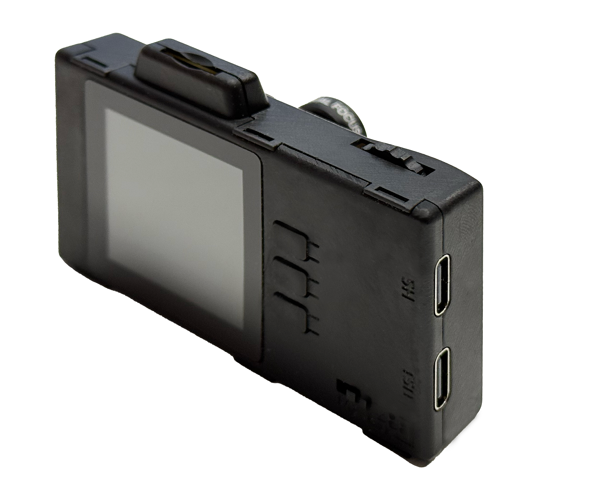

   ESP32-P4X-EYE Front View (click to enlarge)

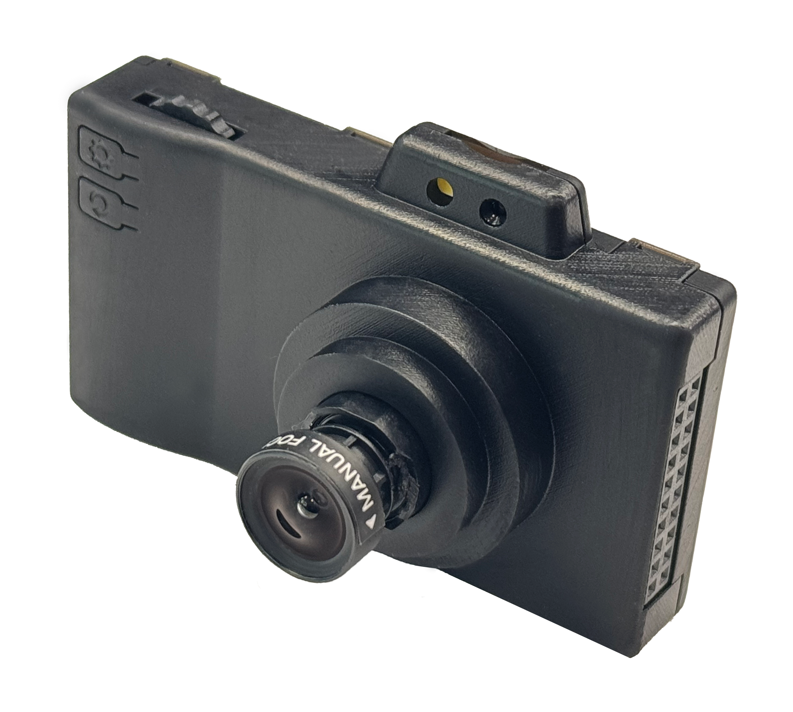

   ESP32-P4X-EYE Back View (click to enlarge)

This guide includes the following sections:

- `Getting Started`_: Overview of ESP32-P4X-EYE and hardware/software setup instructions to get started.
- `Hardware Reference`_: More detailed information about the ESP32-P4X-EYE's hardware.
- `Hardware Revision Details`_: Revision history, known issues, and links to user guides for previous versions (if any) of ESP32-P4X-EYE.
- `Related Documents`_: Links to related documentation.
- `Disclaimer and Copyright Notice`_: Link to the disclaimer and copyright notice.

.. _Getting-started_p4x_eye_0:

Getting Started
===============

This section provides a brief introduction to ESP32-P4X-EYE, instructions on how to do the initial hardware setup and how to flash firmware onto it.

Description of Components
-------------------------

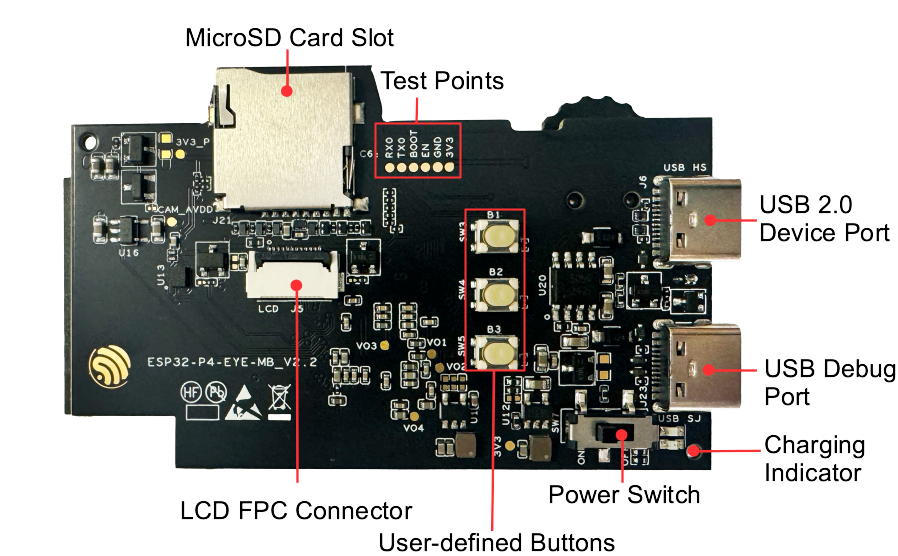

   ESP32-P4X-EYE PCB Top View (click to enlarge)

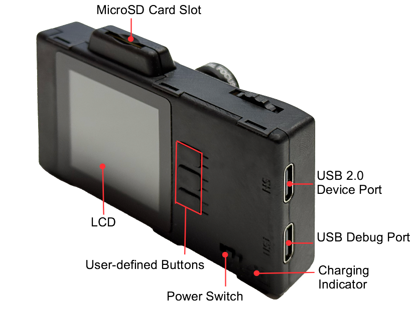

   ESP32-P4X-EYE Front View (click to enlarge)

The key components of the top PCB are described in a clockwise direction. To facilitate use, these components or interfaces are also marked on the ESP32-P4X-EYE enclosure.

.. list-table::
   :widths: 30 70
   :header-rows: 1

   * - Key Component
     - Description
   * - MicroSD Card Slot
     - Supports a MicroSD card through 4-line SD bus with SDIO protocol or SPI protocol.
   * - Test Points
     - Provides access points for programming and testing the ESP32-C6-MINI-1U; can be connected via Dupont wires.
   * - USB 2.0 Device Port
     - Connected to the USB 2.0 OTG High-Speed interface of ESP32-P4, compliant with the USB 2.0 specification. When communicating with other devices via this port, ESP32-P4 acts as a USB device connecting to a USB host. USB 2.0 Device Port can also be used for powering the board.  Marked with ``USB 2.0`` on the enclosure.
   * - USB Debug Port
     - Used for board power, firmware flashing, and connecting to USB-Serial-JTAG interface of ESP32-P4. Marked with ``Debug`` on the enclosure.
   * - Power Switch
     - Flip to "I" to power on the board with 5 V input; flip to "O" to power off.
   * - User-defined Buttons
     - Customizable by user application.
   * - LCD FPC Connector
     - Connects to a 1.54-inch LCD screen.
   * - LCD
     - 1.54-inch LCD with 240 × 240 resolution and SPI interface, capable of displaying real-time images from the camera. For details, refer to `Display Datasheet`_.
   * - Charging Indicator
     - When the battery is charging, the indicator light is red; once charging is complete, the light turns green.

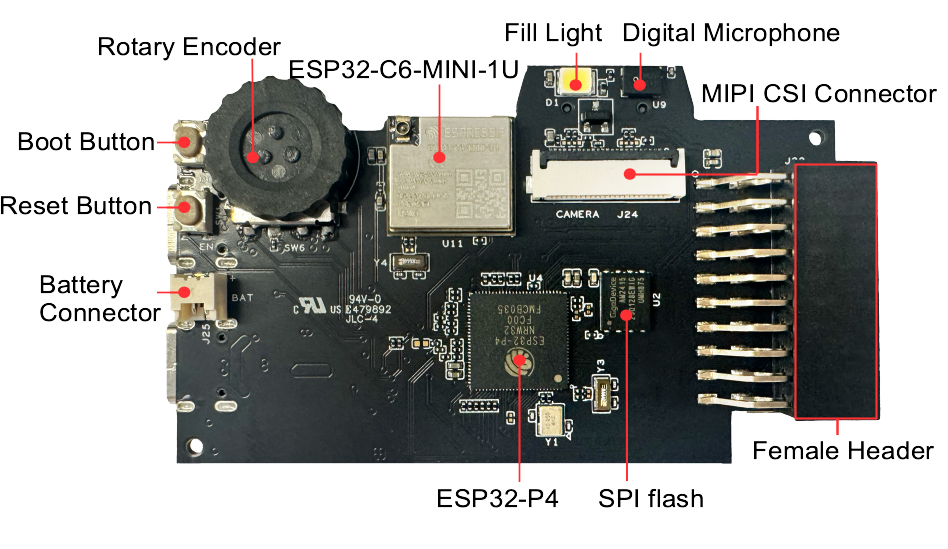

   ESP32-P4X-EYE PCB Bottom View (click to enlarge)

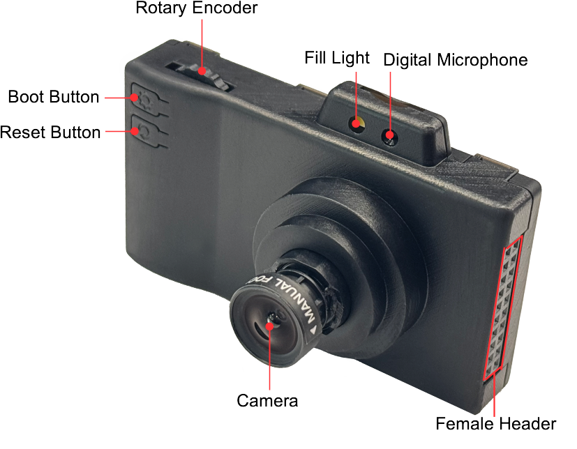

   ESP32-P4X-EYE Back View (click to enlarge)

The key components of the back PCB are described in a clockwise direction. To facilitate use, these components or interfaces are also marked on the ESP32-P4X-EYE enclosure.

.. list-table::
   :widths: 30 70
   :header-rows: 1

   * - Key Component
     - Description
   * - Rotary Encoder
     - You can customize functions based on your application, such as using it to control LCD interface or adjust camera zoom levels.
   * - ESP32-C6-MINI-1U
     - Serves as the Wi-Fi and Bluetooth communication module.
   * - Fill Light
     - Provides illumination for image capture and video recording.
   * - Digital Microphone
     - Used for voice recognition or audio recording.
   * - MIPI CSI Connector
     - Connects to the camera module.
   * - Female Header
     - 2 x 10P header, customizable based on application.
   * - SPI flash
     - 16 MB flash connected via the SPI interface.
   * - ESP32-P4
     - High-performance MCU with large internal memory; supports advanced image and voice processing.
   * - Battery Connector
     - Connects to a lithium battery.
   * - Reset Button
     - Resets the board. Marked with ``↻`` on the enclosure.
   * - Boot Button
     - Controls boot mode. Marked with ``⚙`` on the enclosure. Press the **Reset Button** while holding down the **Boot Button** to reset ESP32-P4 and enter firmware download mode. Firmware can then be downloaded to SPI flash via the USB Debug Port. In general applications, it can act as a confirmation button.
   * - Camera
     - 2 MP resolution with manually adjustable focal length. For details, refer to `Camera Datasheet`_.

Application Examples
--------------------

The following application examples are available for ESP32-P4X-EYE:

- :project:`Factory Demo <examples/esp32-p4-eye/examples/factory_demo>` - Demonstrates a comprehensive mini camera application for ESP32-P4X-EYE that supports photo capture, timed capture, video recording, album preview, USB SD card mounting, image parameter configuration, and AI features including face detection, pedestrian detection, and YOLOv11-nano-based object detection.

For more examples and the latest updates, please refer to the :project:`examples <examples/esp32-p4-eye>` folder.

To explore the application examples or to develop your own, please follow the steps outlined in the `Application Development`_ section.

Application Development
-----------------------

Before powering up your ESP32-P4X-EYE, please make sure that it is in good condition with no obvious signs of damage.

Required Hardware
^^^^^^^^^^^^^^^^^

- ESP32-P4X-EYE
- USB cables
- Computer running Windows, Linux, or macOS

.. note::

  Be sure to use a good quality USB cable. Some cables are for charging only and do not provide the needed data lines nor work for programming the boards.

Optional Hardware
^^^^^^^^^^^^^^^^^

- MicroSD card
- Lithium battery

Hardware Setup
^^^^^^^^^^^^^^

Connect ESP32-P4X-EYE to your computer using a USB cable. The board can be powered through the ``USB 2.0 Device Port`` or ``USB Debug Port``. The ``USB Debug Port`` is recommended for flashing firmware and debugging.

Software Setup
^^^^^^^^^^^^^^

To set up your development environment and flash an application example onto your board, please follow the `installation instructions <https://docs.espressif.com/projects/esp-idf/en/latest/esp32p4/get-started/index.html#installation>`__ in `ESP-IDF Get Started <https://docs.espressif.com/projects/esp-idf/en/latest/esp32p4/get-started/index.html>`__.

Contents and Packaging
----------------------

.. include:: ordering-info.inc

For more information about available variants, visit the `ESP Product Selector <https://products.espressif.com/#/product-selector?names=>`__ and select the **Development Board** tab. If you cannot find the variant you need in the table or Product Selector, or if you have special customization requirements, contact `Espressif Sales <https://www.espressif.com/en/contact-us/sales-questions>`__.

Retail Orders
^^^^^^^^^^^^^

If you order a few samples, each board comes in an individual package in either antistatic bag or any packaging depending on your retailer.

For retail orders, please go to https://www.espressif.com/en/company/contact/buy-a-sample.

Wholesale Orders
^^^^^^^^^^^^^^^^

If you order in bulk, the boards come in large cardboard boxes.

For wholesale orders, please go to https://www.espressif.com/en/contact-us/sales-questions.

.. _Hardware-reference_p4x_eye_0:

Hardware Reference
==================

Functional Block Diagram
------------------------

The block diagram below shows the components of ESP32-P4X-EYE and their interconnections.

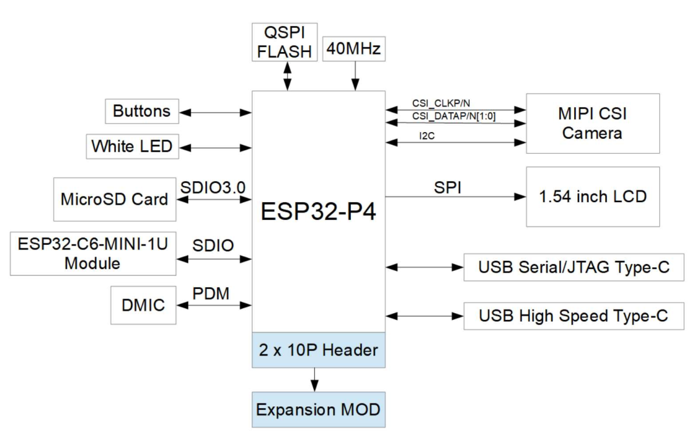

   ESP32-P4X-EYE Functional Block Diagram (click to enlarge)

Power Supply Options
--------------------

ESP32-P4X-EYE can be powered using the following methods:

1. Via the ``USB 2.0 Device Port`` or ``USB Debug Port``

  Connect ESP32-P4X-EYE to a power source using a USB Type-C cable through either of the two ports. If a lithium battery is already installed, it will be charged simultaneously.

2. Via the ``Battery Connector``

  To use this method, first open the enclosure, then connect the battery to the Battery Connector. The lithium battery must not exceed 4 mm × 25 mm × 45 mm in size. It should use a 1.25 mm pitch connector, and the polarity must match the markings on the PCB.

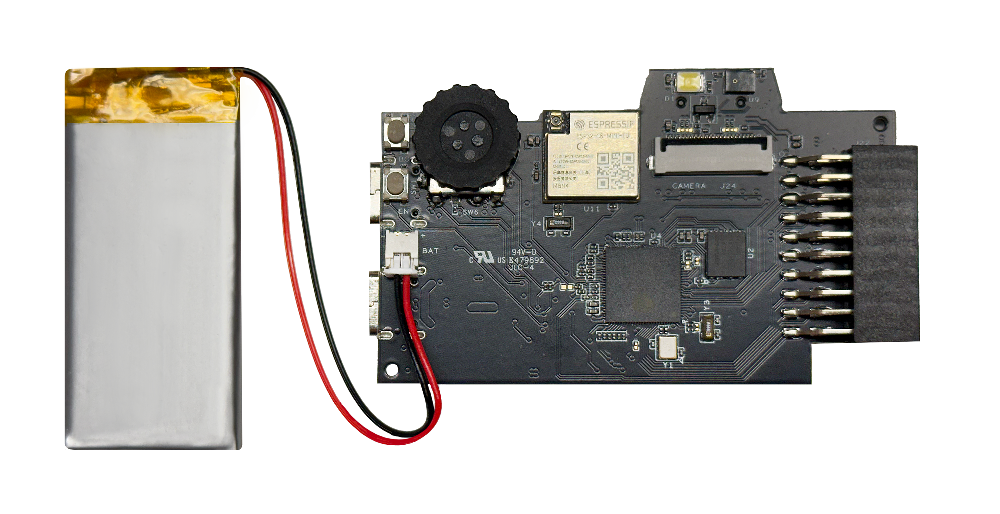

   Battery Connection (click to enlarge)

Female Header
-------------

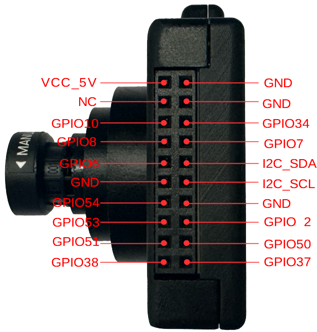

   Female Header (click to enlarge)

USB 2.0 Device Port Circuit
---------------------------

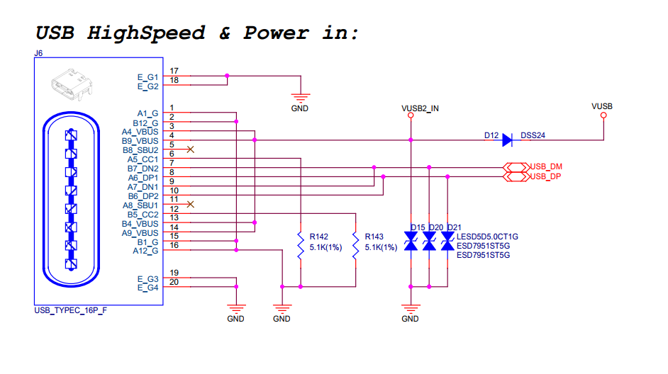

   USB 2.0 Device Port Circuit (click to enlarge)

LCD Circuit
-----------

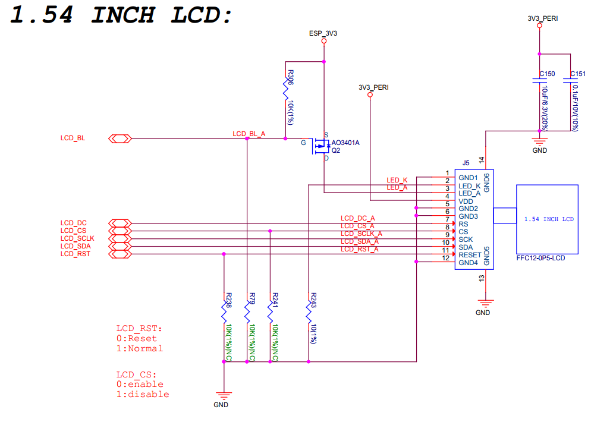

   LCD Circuit (click to enlarge)

Please note that this interface supports SPI displays. ESP32-P4X-EYE features the `ST7789 <https://dl.espressif.com/AE/esp-dev-kits/ST7789VW芯片手册.pdf>`_, which uses the ``LCD_BL`` pin (GPIO20) to control the backlight.

MicroSD Card Slot Interface Circuit
-----------------------------------

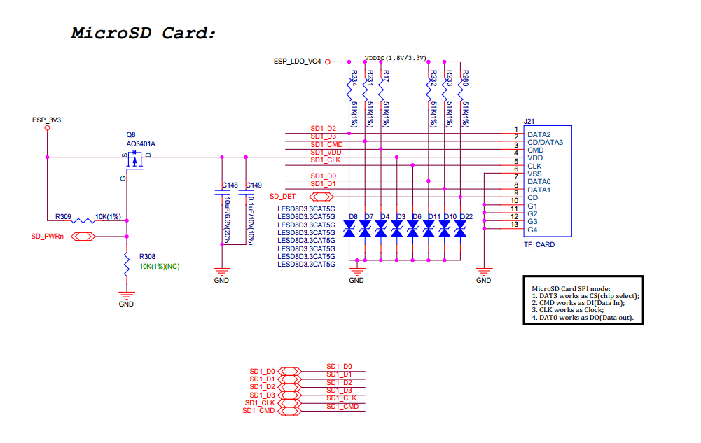

   MicroSD Card Slot Interface Circuit (click to enlarge)

**Please note that the MicroSD card interface supports:**

* 1-bit and 4-bit SD bus configurations
* Communication via SDIO protocol or SPI protocol

Charging Circuit
----------------

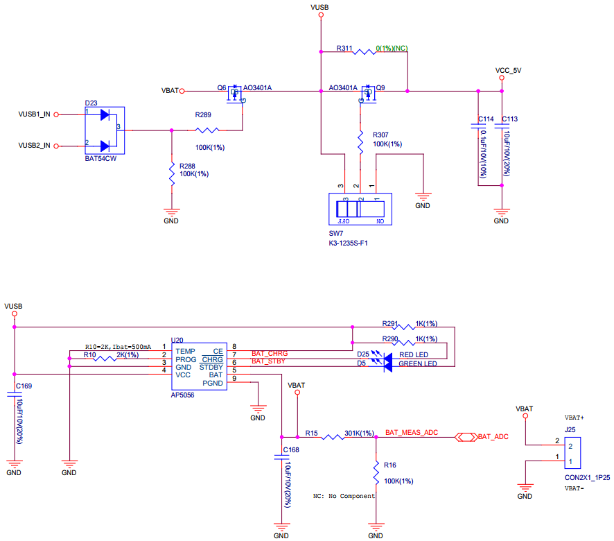

   Charging Circuit (click to enlarge)

Microphone Circuit
------------------

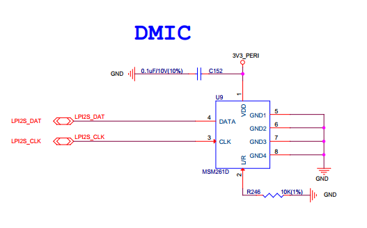

   Microphone Circuit (click to enlarge)

Camera Circuit
--------------

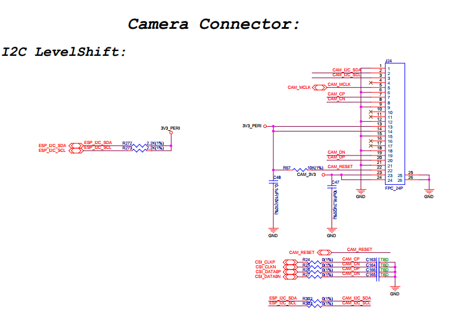

   Camera Circuit (click to enlarge)

Rotary Encoder Circuit
----------------------

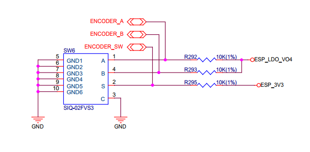

   Rotary Encoder Circuit (click to enlarge)

ESP32-C6-MINI-1U Module Circuit
-------------------------------

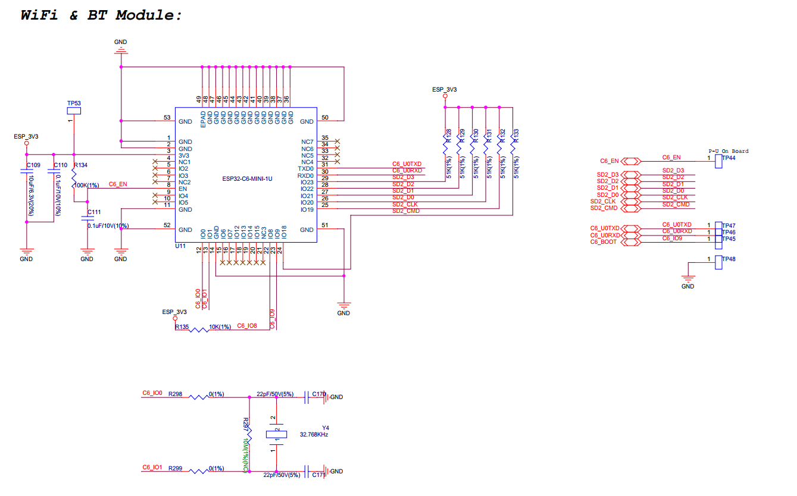

   ESP32-C6-MINI-1U Module Circuit (click to enlarge)

Hardware Revision Details
=========================

The difference between the ESP32-P4X-EYE and the :doc:`ESP32-P4-EYE <../esp32-p4-eye/user_guide>` is that the main chip on the former has been upgraded to the ESP32-P4 chip revision v3.1 or later version.

.. _Related-documents_p4x_eye_0:

Related Documents
=================

.. only:: latex

   Please download the following documents from `the HTML version of esp-dev-kits Documentation <https://docs.espressif.com/projects/esp-dev-kits/en/latest/{IDF_TARGET_PATH_NAME}/index.html>`_.

-  `ESP32-P4X-EYE Reference Design`_ (ZIP)
-  `Camera Datasheet`_ (PDF)
-  `Display Datasheet`_ (PDF)
-  `ST7789VW Datasheet`_ (PDF)
-  `OV2710 Overview`_ (PDF)

.. _ESP32-P4X-EYE Reference Design: https://documentation.espressif.com/ESP32-P4X-EYE-EN.zip
.. _ST7789VW Datasheet: https://dl.espressif.com/AE/esp-dev-kits/ST7789VW芯片手册.pdf
.. _OV2710 Overview: https://dl.espressif.com/AE/esp-dev-kits/ov2710pbv1.1web.pdf
.. _Camera Datasheet: https://dl.espressif.com/AE/esp-dev-kits/HDF2710-47-MIPI-V2.0.pdf
.. _Display Datasheet: https://dl.espressif.com/AE/esp-dev-kits/胶铁一体ZJY154KC-IF17.pdf

Disclaimer and Copyright Notice
===============================

See :doc:`Disclaimer and Copyright Notice <../disclaimer-and-copyright>`.

